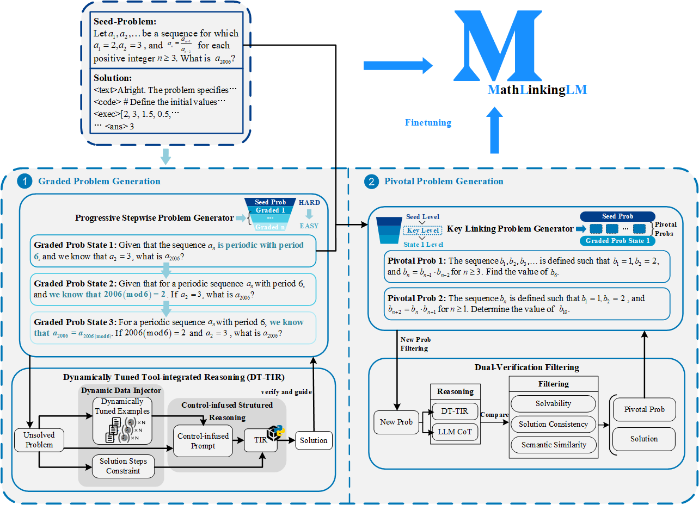

# MathLinking
open source for MathLinking paper

Our paper use mathcoder-instruction 80k as seed problem to improve data. Here is data source link https://huggingface.co/datasets/MathLLMs/MathCodeInstruct.

We use LLM-Adapters https://github.com/AGI-Edgerunners/LLM-Adapters to finetuning seed data and LinkingData 41k.
